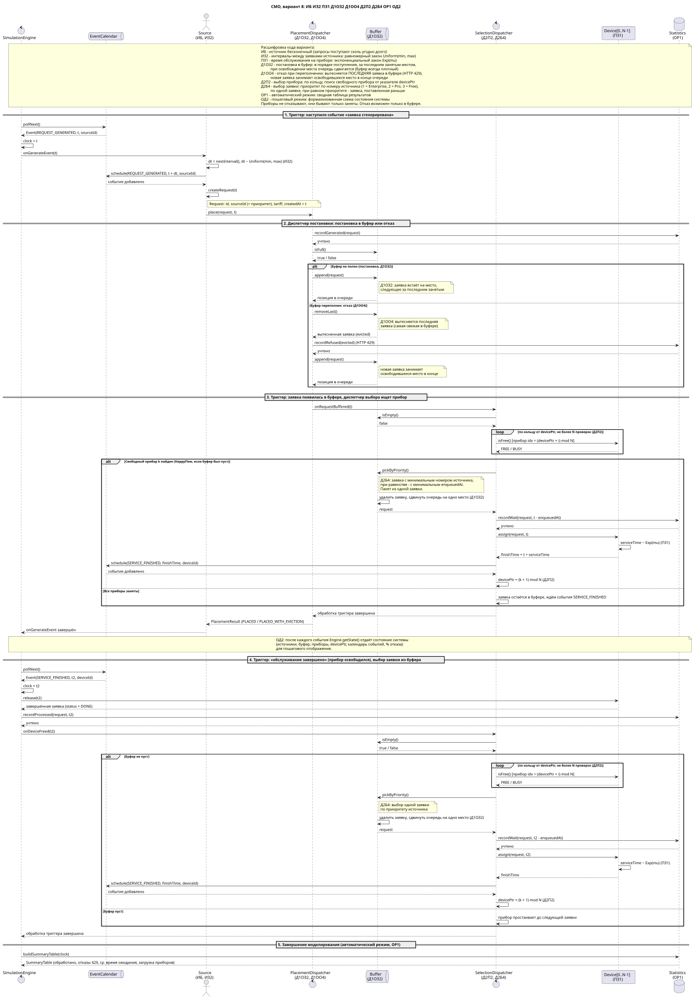
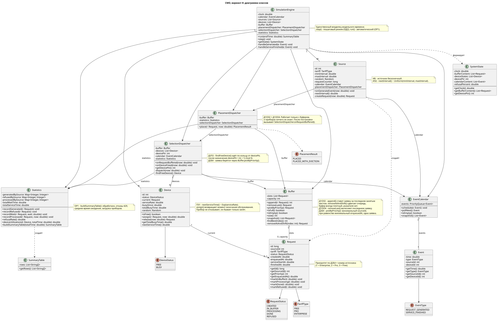
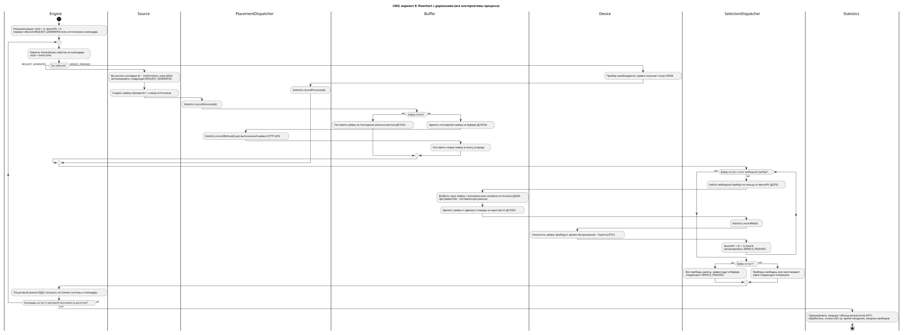

# Очередь запросов к API генеративной ИИ-модели

Имитационная модель системы массового обслуживания (СМО).

Автор: Владимирова А. А.

## Вариант 8

| ИБ | ИЗ2 | ПЗ1 | Д1ОЗ2 | Д1ОО4 | Д2П2 | Д2Б4 | ОР1 | ОД2 |
|----|-----|-----|-------|-------|------|------|-----|-----|

### Расшифровка кода варианта

| Код | Расшифровка |
|---|---|
| **ИБ** | Источник бесконечного типа: запросы могут поступать сколь угодно долго |
| **ИЗ2** | Закон генерации заявок: равномерный, интервал ~ Uniform(min, max) |
| **ПЗ1** | Закон обслуживания на приборе: экспоненциальный, время ~ Exp(mu) |
| **Д1ОЗ2** | Дисциплина постановки в буфер: в порядке поступления, заявка занимает место, следующее за последним занятым. При освобождении места все заявки за ним сдвигаются вперёд, очередь всегда плотная |
| **Д1ОО4** | Дисциплина отказа: при переполнении буфера отказ (HTTP 429) получает последняя заявка в буфере, новая заявка занимает освободившееся место в конце очереди |
| **Д2П2** | Выбор прибора: по кольцу, свободный прибор ищется циклически от указателя `devicePtr`, после назначения `devicePtr = (k + 1) mod N` |
| **Д2Б4** | Выбор заявки из буфера: приоритет по номеру источника (1 = Enterprise, 2 = Pro, 3 = Free), по одной заявке. При равном приоритете выбирается заявка, поставленная в буфер раньше |
| **ОР1** | Автоматический режим: сводная таблица результатов |
| **ОД2** | Пошаговый режим: формализованная схема модели, текущее состояние |

## Бизнес-домен

**Очередь запросов к облачному API генеративной ИИ-модели (далее «Сервис»).**

Разработчики и приложения, подключённые по API-ключам тарифов Free, Pro и Enterprise, отправляют запросы на генерацию текста. Из-за ограниченного числа GPU-серверов обработать все запросы одновременно невозможно, поэтому Сервис ставит запросы в очередь, а при её переполнении отклоняет часть запросов (HTTP 429 «Too Many Requests»).

### Маппинг домена на элементы СМО

| Элемент СМО | Сущность бизнес-домена | Назначение |
|---|---|---|
| Источник (ИБ, ИЗ2) | Клиентские приложения тарифов Free / Pro / Enterprise | Бесконечный поток запросов, интервалы между запросами распределены равномерно |
| Заявка | Запрос к API (промпт, параметры генерации, тариф) | Содержит номер источника (приоритет), время создания, время постановки в буфер, статус |
| Буфер (Д1ОЗ2) | Очередь запросов Сервиса | Плотный список ограниченной ёмкости со сдвигом при освобождении места |
| Прибор (ПЗ1) | GPU-сервер инференса | Обрабатывает один запрос за раз, время обслуживания экспоненциальное. Прибор не отказывает, он бывает только занят |
| Диспетчер постановки (Д1ОЗ2, Д1ОО4) | API Gateway / менеджер очереди | Ставит заявку в буфер, при переполнении вытесняет последнюю заявку (отказ 429) |
| Диспетчер выбора (Д2П2, Д2Б4) | Планировщик / балансировщик нагрузки | Ищет свободный GPU по кольцу и выбирает из буфера одну заявку с наивысшим приоритетом источника |
| Отказ | Ответ HTTP 429 | Возникает только в буфере |
| ОР1 | Сводная таблица | Обработано, отказы, среднее время ожидания, загрузка приборов |
| ОД2 | Формализованная схема | Состояние источников, буфера, приборов, указателя и календаря событий на каждом шаге |

## Проектные решения

- **Классическая схема диспетчеров.** Диспетчер постановки работает только с буфером и о приборах ничего не знает. Любая заявка сначала попадает в буфер, а затем диспетчер выбора сразу забирает её на свободный прибор, если он есть. Это и есть Happy Flow: буфер пуст, прибор свободен.
- **Триггеры диспетчеров.** Событие «заявка сгенерирована» запускает диспетчер постановки, а после постановки в буфер запускается диспетчер выбора. Событие «обслуживание завершено» освобождает прибор и запускает диспетчер выбора.
- **Единый календарь событий.** Двигает модельное время `SimulationEngine`, события хранятся в `EventCalendar` (`REQUEST_GENERATED`, `SERVICE_FINISHED`).
- **Указатель.** По Д2П2 указатель `devicePtr` есть только у приборов. У буфера (Д1ОЗ2) указателя нет.
- **Пакет** по Д2Б4 состоит из одной заявки.

## Артефакты (шаг 2)

| Артефакт | Исходник | Картинка |
|---|---|---|
| Сиквенс: Happy Flow, постановка и выборка из буфера, отказ при переполнении, постановка на прибор | [step2/sequence/smo_v8_sequence.puml](step2/sequence/smo_v8_sequence.puml) |  |
| Диаграмма классов | [step2/class/smo_v8_classes.puml](step2/class/smo_v8_classes.puml) |  |
| Flowchart с дорожками | [step2/flowchart/smo_v8_flowchart.puml](step2/flowchart/smo_v8_flowchart.puml) |  |

## Структура репозитория

```
├─ README.md
├─ step2/
│  ├─ sequence/    (.puml + .svg)
│  ├─ class/       (.puml + .svg)
│  └─ flowchart/   (.puml + .svg)
└─ step3/          (программная реализация — следующий шаг, пока не добавлена)
```
